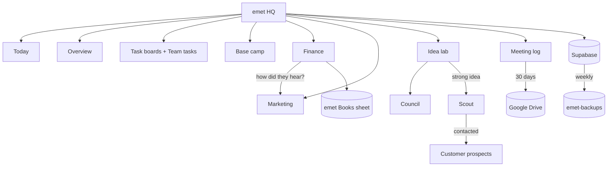

# Systems map

| System | Note |
|---|---|
| [[emet HQ (dashboard)]] | The app |
| [[Today]] · [[Overview (company dashboard)]] | Home + company view |
| [[Task boards]] · [[Team tasks]] | Work |
| [[Base camp]] | Private |
| [[Finance tab]] · [[Marketing section]] | Teams |
| [[Idea lab]] · [[Idea lab council]] · [[Scout (lead finder)]] | Find what to sell + who to sell to |
| [[Meeting log]] · [[Workspace tools]] | Collaboration |
| [[Backups & reliability]] · [[Shared Claude skills]] | Behind the scenes |

Back to [[🏔️ emet Dashboard]]
